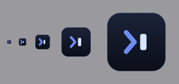
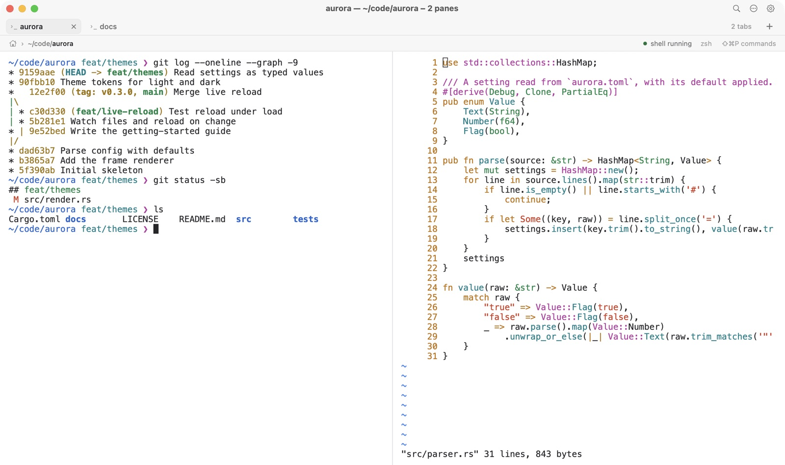
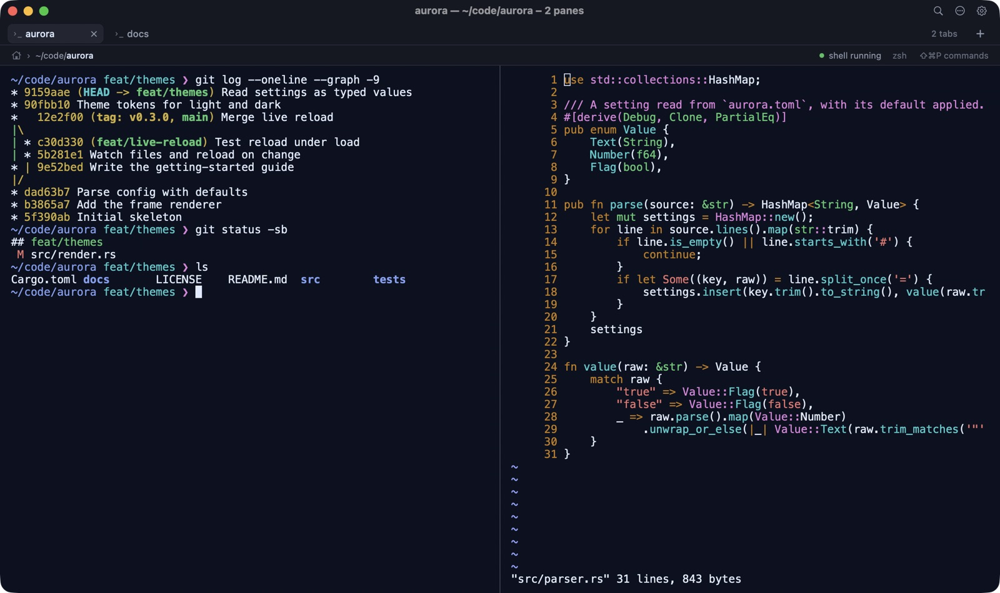
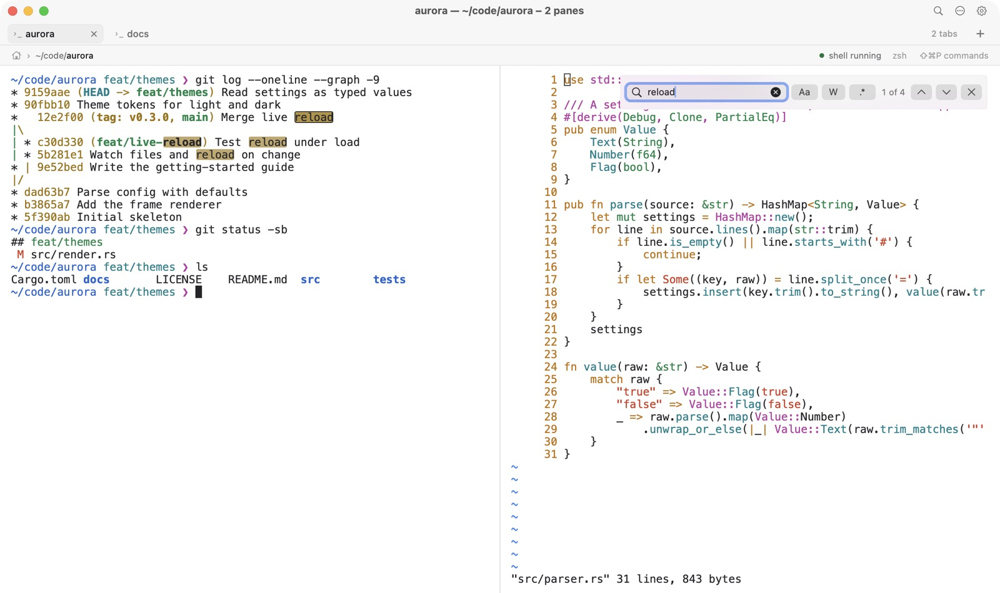
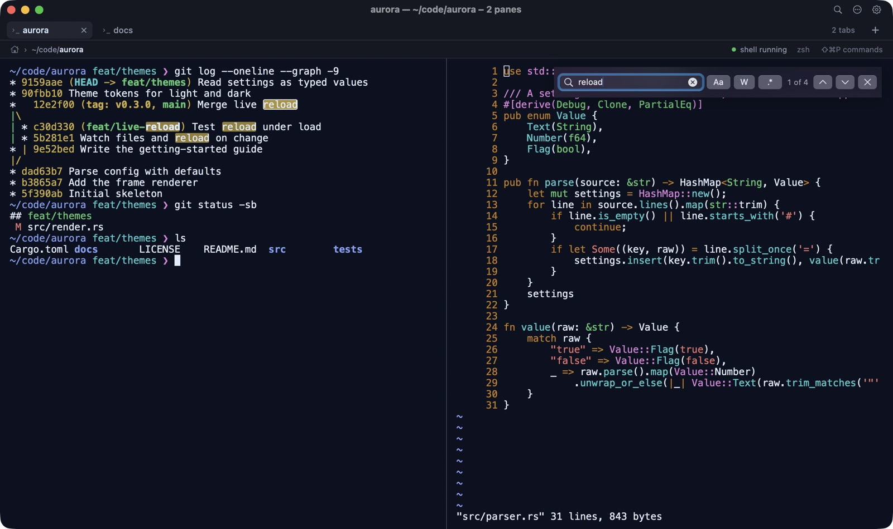
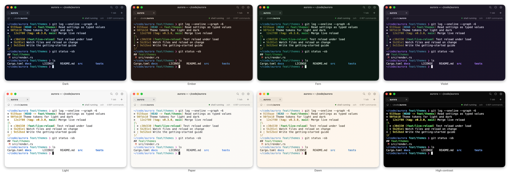
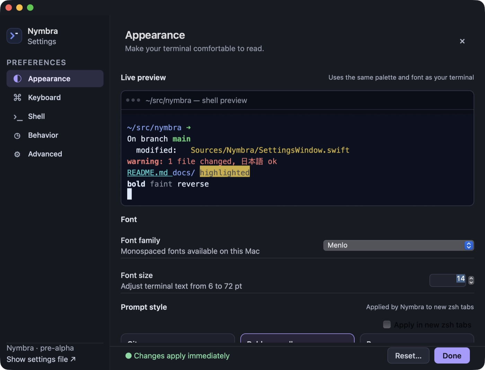

<p align="center">
  
</p>

<h1 align="center">Nymbra</h1>

<p align="center">
  A native, quiet terminal for macOS, written from scratch.<br/>
  AppKit, CoreText and a POSIX pseudo-terminal. No web view, no third-party code.
</p>

<p align="center">
  <a href="https://github.com/Davin-X/nymbra/releases"></a>
  <a href="https://github.com/Davin-X/nymbra/actions/workflows/ci.yml"></a>
  <a href="LICENSE"></a>
  
  <a href="docs/ARCHITECTURE.md"></a>
</p>

<p align="center">
  <picture>
    <source media="(prefers-color-scheme: dark)" srcset="docs/screenshots/terminal-dark.jpg">
    
  </picture>
</p>
<p align="center"><sub>Shown in your GitHub theme. Every screen in the <a href="#tour">tour</a> appears in both light and dark.</sub></p>

Nymbra is the terminal you leave open all day. It knows which folder each tab is in and what is running there, tells you when a long command finishes in a tab you aren't looking at, and stays out of the way the rest of the time. It is a single native app built only on Apple's frameworks, so there is nothing else to install and nothing phoning home.

> **Status: 0.1.0, early.** Nymbra runs your login shell, full-screen programs like vim, htop and lazygit, tabs and splits, and search. It is not yet a full replacement for iTerm2 or Ghostty: session restore and a Metal renderer are still to come. See the [roadmap](#roadmap).

## Contents

- [Features](#features)
- [Tour](#tour)
- [Install](#install)
- [Keyboard shortcuts](#keyboard-shortcuts)
- [Settings](#settings)
- [Privacy](#privacy)
- [Build from source](#build-from-source)
- [How it works](#how-it-works)
- [Roadmap](#roadmap)
- [Troubleshooting](#troubleshooting)
- [Contributing](#contributing)

## Features

- **Knows where you are.** Tabs and the window are named after the folder or the running program (`aurora`, `vim`), never "Terminal". A thin path bar shows the folder and whether the shell is idle or busy; click it to open the folder in Finder.
- **Tabs and splits.** Split right or down, move between panes from the keyboard, and drag tabs to reorder them. Every tab and pane has its own shell.
- **Search the scrollback.** <kbd>⌘</kbd> <kbd>F</kbd> finds text in everything you have scrolled past, with match case, whole word and regular expressions. The current match stands out from the others.
- **Hears when a command finishes.** With shell integration on, a long command that finishes in a background tab is announced, and clicking the notification brings that tab forward. A short attention list keeps what needs you, without a stream of alerts.
- **Eight palettes that stay readable.** Dark, Ember, Fern, Violet, Light, Paper, Dawn and High contrast. Every colour clears WCAG AA (4.5:1) against its background. That's checked by the tests, and colours that programs pick are lifted to clear it too.
- **Settings with a live preview.** The preview is a real terminal drawn with your font and palette. Pick a prompt style from the gallery and new zsh tabs use it, without Nymbra touching your dotfiles.
- **Correct input and output.** Input methods (Japanese, Chinese, Korean, dead keys, press-and-hold accents), synchronized output so editors redraw without tearing, mouse reporting, reflow on resize, and a command palette for everything in the menus.
- **Nothing extra.** No account, no telemetry, no update pings, no third-party code. Settings are one JSON file you can read.

## Tour

### Terminal

<table>
  <tr>
    <th>Light</th>
    <th>Dark</th>
  </tr>
  <tr>
    <td></td>
    <td></td>
  </tr>
</table>

The title bar, tabs, path bar and terminal share one surface in the palette's own colours. The tab says which folder you are in. The path bar's right side says `shell running` at a prompt and `running vim` while a program has the foreground.

### Find

<table>
  <tr>
    <th>Light</th>
    <th>Dark</th>
  </tr>
  <tr>
    <td></td>
    <td></td>
  </tr>
</table>

Search covers the whole scrollback, not just the screen. <kbd>⌘</kbd> <kbd>G</kbd> and <kbd>⇧</kbd> <kbd>⌘</kbd> <kbd>G</kbd> step through matches and scroll to each one.

### Palettes

<p align="center">
  
</p>

Each palette has its own hues, not a recolour of one table, and the window chrome follows it. Override any single colour in the settings file.

### Settings

<p align="center">
  
</p>

Changes apply to open terminals as you make them. **Reset** shows what will change before it changes anything.

<sub>The screenshots show a demo project made for them. Nothing in them comes from a real account.</sub>

## Install

1. Download `Nymbra.zip` from [GitHub Releases](https://github.com/Davin-X/nymbra/releases). It runs on Apple Silicon Macs.
2. Unzip it and drag **Nymbra.app** into **Applications**.
3. Open it.

### macOS Gatekeeper (unsigned build)

Nymbra is not signed or notarized yet, so macOS will say it can't verify the developer. Either right-click the app, choose **Open**, then **Open** again, or run:

```bash
xattr -dr com.apple.quarantine /Applications/Nymbra.app
```

Prefer not to? [Build it yourself](#build-from-source). It takes about a minute and needs only the Xcode Command Line Tools.

## Keyboard shortcuts

| Shortcut | Action |
|---|---|
| <kbd>⌘</kbd> <kbd>N</kbd> | New window |
| <kbd>⇧</kbd> <kbd>⌘</kbd> <kbd>T</kbd> | New tab |
| <kbd>⇧</kbd> <kbd>⌘</kbd> <kbd>]</kbd> / <kbd>⇧</kbd> <kbd>⌘</kbd> <kbd>[</kbd> | Next or previous tab |
| <kbd>⇧</kbd> <kbd>⌘</kbd> <kbd>W</kbd> | Close tab |
| <kbd>⌘</kbd> <kbd>D</kbd> | Split right |
| <kbd>⇧</kbd> <kbd>⌘</kbd> <kbd>D</kbd> | Split down |
| <kbd>⌘</kbd> <kbd>]</kbd> / <kbd>⌘</kbd> <kbd>[</kbd> | Next or previous pane |
| <kbd>⌘</kbd> <kbd>W</kbd> | Close pane |
| <kbd>⌘</kbd> <kbd>F</kbd> | Find |
| <kbd>⌘</kbd> <kbd>G</kbd> / <kbd>⇧</kbd> <kbd>⌘</kbd> <kbd>G</kbd> | Next or previous match |
| <kbd>⌘</kbd> <kbd>K</kbd> | Clear the buffer |
| <kbd>⇧</kbd> <kbd>⌘</kbd> <kbd>P</kbd> | Command palette |
| <kbd>⌘</kbd> <kbd>=</kbd> / <kbd>⌘</kbd> <kbd>-</kbd> | Bigger or smaller text |
| <kbd>⌃</kbd> <kbd>⌘</kbd> <kbd>F</kbd> | Full screen |
| <kbd>⌘</kbd> <kbd>,</kbd> | Settings |

Most of them can be changed in **Settings → Keyboard**, which records a shortcut as you press it.

## Settings

Everything lives in one hand-editable file:

```
~/Library/Application Support/Nymbra/config.json
```

Loading never fails. A missing file means the defaults, a broken one means the defaults plus a warning, and keys from a newer version are ignored, so a terminal never refuses to start because of its own settings. Set `$NYMBRA_CONFIG` to use a different file. [docs/CONFIG.md](docs/CONFIG.md) lists every key.

**Shell integration** (`"behaviour": { "shellIntegration": true }`, off by default, zsh for now) lets the shell report where each prompt and command starts and how it ended. That powers finished-command notifications and the attention list. Like the prompt gallery, it works through a generated `ZDOTDIR` that loads your own startup files first. Nymbra never edits your dotfiles, and turning it off leaves nothing behind.

## Privacy

Nymbra makes no network requests. There is no account, no analytics and no update check. It reads its settings file and runs the shell you ask for, and that's all. The one optional exception is the system notification for a finished command, which stays on your Mac.

## Build from source

You need macOS 11 or later and the Xcode Command Line Tools (`xcode-select --install`). Full Xcode is not required, and Swift 6.0 or later comes with the tools.

```bash
git clone https://github.com/Davin-X/nymbra.git
cd nymbra
make app        # build/Nymbra.app, icon and all
```

Then:

```bash
make launch     # build it and open it
```

```bash
make install    # copy it to /Applications (or ~/Applications)
```

```bash
make dist       # build/Nymbra.zip, ready to send
```

The icon is drawn by [`Scripts/make-icon.swift`](Scripts/make-icon.swift) at build time instead of being stored as a binary, so it is reviewable and uses the terminal's own colours.

### Tests

```bash
make check
```

`make check` is what CI runs and must pass before any change is merged. It runs the unit suites, then a set of proofs that start the real app headlessly and assert, in text, what a person would otherwise check by eye: that the shell gets the grid the view draws, that a find highlight is the colour it claims, that tabs keep separate shells, and that an input method composes before it commits. [CONTRIBUTING.md](CONTRIBUTING.md) lists every target and flag.

## How it works

```
                ┌──────────────┐
                │   Nymbra     │  windows, tabs, settings, CoreText renderer
                └──────┬───────┘
                       │ depends on
                ┌──────▼───────┐
                │ NymbraCore   │  PTY, VT parser, screen model, config, palettes
                └──────┬───────┘
                       │ depends on
                ┌──────▼───────┐
                │    CPTY      │  openpty() + posix_spawn() / TIOCSWINSZ
                └──────┬───────┘
                       │ execs, with the terminal inherited
                ┌──────▼───────┐
                │ NymbraSpawn  │  setsid() + TIOCSCTTY + execv: claims the shell's terminal
                └──────────────┘
```

- **One-way dependencies.** `NymbraCore` and `CPTY` may not import a UI framework, and CI enforces it with [`Scripts/check-architecture.sh`](Scripts/check-architecture.sh). That's what lets the whole emulator be tested without a window.
- **A real terminal for the shell.** `NymbraSpawn` is a tiny helper that makes the pseudo-terminal the shell's controlling terminal, which is why <kbd>⌃</kbd> <kbd>C</kbd> and job control work. See [ADR-0008](docs/adr/0008-the-helper-owns-the-terminal.md).
- **Where the shell is.** The folder comes from `OSC 7` when the shell reports it, and otherwise from the shell process itself. The foreground program comes from the terminal's process group.
- **Calm redraws.** Output is coalesced before drawing, and programs that use synchronized output (DEC mode 2026) get whole frames, not half-drawn ones.

The full picture, including the threading model and invariants, is in [docs/ARCHITECTURE.md](docs/ARCHITECTURE.md). Decisions are recorded in [docs/adr/](docs/adr/), and [docs/research/TERMINAL-LANDSCAPE.md](docs/research/TERMINAL-LANDSCAPE.md) compares Nymbra with other terminals.

## Roadmap

| Milestone | Scope | Status |
|---|---|---|
| M0 | PTY, window, CoreText grid, tests, CI | ✅ done |
| M1 | VT emulation, keyboard, scrollback, tabs and splits | ✅ done |
| M2 | Settings, palettes, select and copy | ✅ done |
| M3 | Search, reflow, mouse, input methods, synchronized output | ✅ done · Metal renderer next |
| M4 | Shell integration, notifications, folder-aware titles | 🔨 zsh done · bash, fish and a command timeline next |
| M5 | Sessions that outlive the window | planned |
| M6 | Signed, notarized release and updater | 🔨 bundle and icon done · signing next |

Full plan and acceptance criteria: [docs/ROADMAP.md](docs/ROADMAP.md). What changed in each version: [CHANGELOG.md](CHANGELOG.md).

## Troubleshooting

- **macOS blocks the app.** See [Gatekeeper](#macos-gatekeeper-unsigned-build).
- **Tab names show the shell, not the folder.** Set `"shellIntegration": true` under `behaviour` in the settings file and open a new tab, or make sure your shell reports `OSC 7`.
- **A prompt style or shell integration change did nothing.** Both apply to shells started afterwards. Open a new tab.
- **`make` fails with a missing compiler.** Install the Command Line Tools with `xcode-select --install` and try again.
- **Still stuck?** Open an [issue](https://github.com/Davin-X/nymbra/issues) with your macOS version and what you ran.

## Contributing

Issues and pull requests are welcome. Please read [CONTRIBUTING.md](CONTRIBUTING.md) first, in particular the architecture rule and the requirement that `make check` passes.

## License

[MIT](LICENSE). Built only on Apple's frameworks. The default typeface is the system's Menlo, and no font is redistributed.
